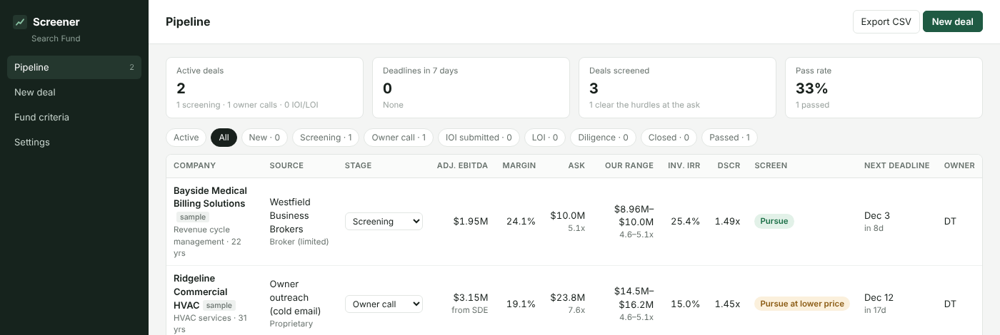
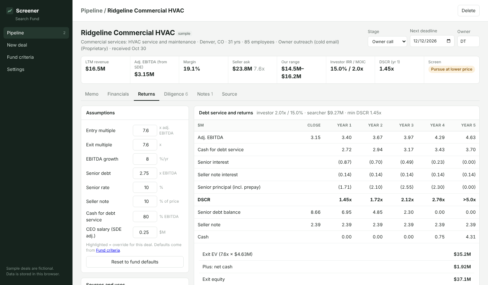

# Screener

A deal-screening workspace for a search fund. A broker profile or CIM goes in. Out comes a corrected set of financials, a screen against the fund's criteria, a priced deal structure, and a 2-page memo, and every deal is tracked from first look to LOI.

**Try it:** https://dt-pr29.github.io/screener/ opens with three fictional sample deals. No login or API key is needed to explore.



## The problem

As a search fund analyst, I screened small owner-operated businesses ($1–5M EBITDA) by hand. The steps were the same on every deal, and most of the time went to the mechanical parts:

1. **Read the materials** and pull out the financials. They often come as SDE (seller's discretionary earnings), which includes the owner's own salary.
2. **Normalize earnings:** what does the business earn once you pay a CEO?
3. **Check the fund's criteria:** size, margin, growth, concentration, durability, and whether the owner actually wants to leave.
4. **Structure and price it:** how much senior debt and seller note the business can carry, and the highest price that still covers debt service and returns what investors need.
5. **Write it up and track it:** memo, diligence questions, owner call notes, deadlines.

Screener follows that same sequence. I mapped my own workflow first and then built the tool around it, so nobody has to change how they work to use it.

## Where AI helps, and where it doesn't

This was the main design decision.

| Step | Who does it | Why |
|---|---|---|
| Reading a 40-page CIM and pulling out financials, ask, owner plans | **Claude** (structured extraction) | This is slow for people and a strength for language models. Output is a fixed schema, not free text. |
| Drafting thesis, risks and diligence questions | **Claude** | A useful first draft that the analyst edits. |
| Correcting extracted numbers | **The analyst** | Extraction is a draft. Every field is editable, and the tool recalculates from what the analyst approves. |
| SDE normalization, debt schedule, DSCR, IRR, pricing | **Plain code** (`model.js`) | Models are unreliable at arithmetic, and investment math has to be checkable. It's covered by tests. |
| Pass / pursue / price | **Code, from the fund's own criteria** | The decision rules are explicit and editable. The model is told not to value or recommend. |

The model reads and drafts. Code does the math and applies the rules. People own the numbers and the decision.

## What's in it

- **Pipeline:** source, stage (screening → owner call → IOI → LOI → diligence), adjusted EBITDA, seller ask vs. our range, investor IRR, DSCR, screen result, next deadline and owner. Exports to CSV.
- **Deal page:** a printable memo; editable financials; returns (sources and uses, a 5-year debt schedule with DSCR, the searcher and investor split, sensitivity, and a max price that clears both the IRR hurdle and the lender's minimum coverage); a diligence checklist; an activity log; and the source materials.
- **Fund criteria:** the fund's box and standard deal terms in one place. Change one and the whole pipeline is re-screened.



## Built to be maintained

A tool only helps if the team can keep using it after the person who built it leaves.

- **No build step, no server, no framework.** Four files: `index.html` (layout), `app.js` (screens and the Claude call), `model.js` (all deal math), `samples.js` (demo data). Hosting is GitHub Pages.
- **Rules are settings, not code.** Thresholds and deal terms live on the Fund criteria page, so changing the fund's box doesn't require a developer.
- **The math is isolated and tested.** `npm test` checks sources and uses, a hand-calculated DSCR, SDE normalization and the price solver.
- **No secrets in the repo.** Each user enters their own API key in Settings. It's sent only to api.anthropic.com.

```bash
python3 -m http.server   # open http://localhost:8000
npm test
```

## What I'd change next

- **Shared storage.** Deals currently live in one person's browser. A team needs one pipeline, so this would move to a shared database.
- **Downside case:** test the DSCR covenant every year under a lost top customer or margin compression.
- **Outcome tracking:** compare the tool's price ranges with where deals actually traded, to calibrate the defaults.

---

Built by Devansh Trivedi, with Claude as a coding partner. Sample companies, brokers and figures are fictional.
